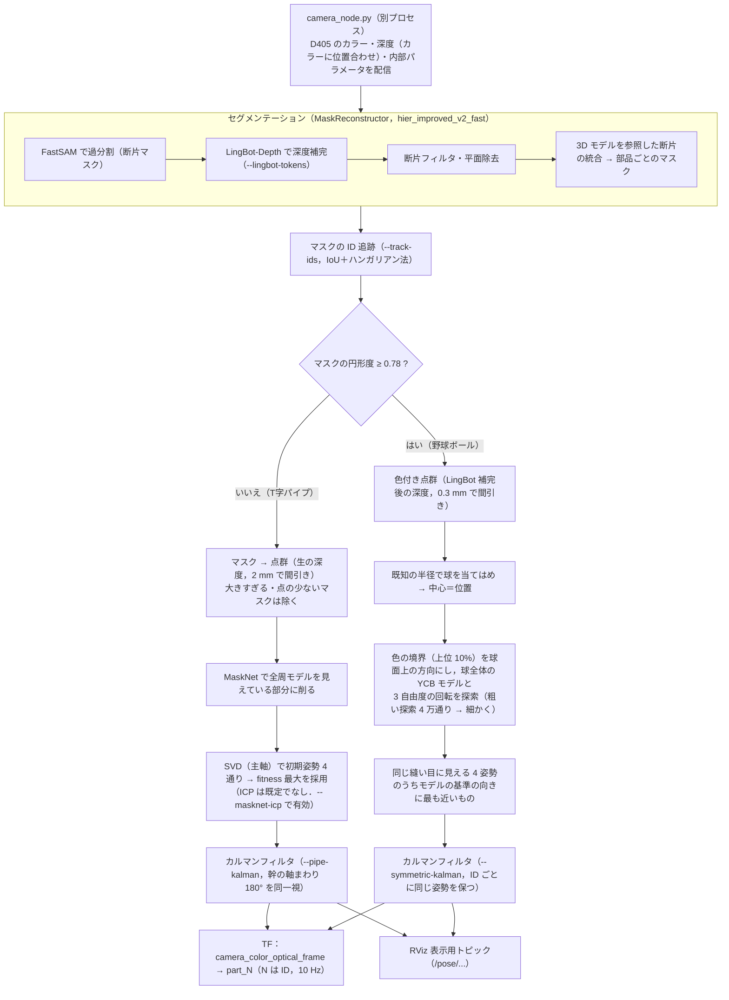

# mask_reconstruction

バラ積み部品（T字管など）に対する，**FastSAM および 3D モデルを参照した統合によるセグメンテーションマスク再構築**．

`../3Dto2D/` の最新手法（2026-07-31 最終バッチ評価, `run_batch_evaluation.py`）を整理したもの．
アルゴリズム・パラメータは同一で，評価値が完全に一致することを確認済み．

## 手法

1. **FastSAM** で画像全体を過分割し，断片マスクを得る（面積 1000px 未満は除去）
2. **LingBot-Depth** で D405 深度を補完（メディアンとの差 20mm 超の飛び値を欠損扱いにして入力）し，点群化
3. 黒背景（トレイ）が主体の断片・有効 3D 点が 50 点以下の断片を除去
4. 断片ごとに 3D 点群の **PCA（重心・第1主軸）** を求め，断片間の距離行列を作る
   - 2D で隣接 かつ 境界の深度差 < 8mm → 同一部品（距離 0.1）
   - それ以外 → `115·|重心差| + (5·角度差 + 5·主軸ずれ)·L_cad`（隣接で深度不連続なら +10）
5. **階層クラスタリング**（average linkage, 閾値 1.5）で断片を統合し，部品ごとのマスクとする

## 構成

```
mask_reconstruction/
├── mask_reconstruction/     # 手法本体
│   ├── config.py            # 全パラメータ（Config）
│   ├── io.py                # データ読み込み（RGB・深度・内部パラメータ・COCO GT）
│   ├── depth.py             # 深度前処理・LingBot-Depth・点群化   … 手順 2
│   ├── fragments.py         # FastSAM / YOLO26・断片フィルタ        … 手順 1, 3
│   ├── merging.py           # PCA・距離行列・階層クラスタリング      … 手順 4, 5
│   ├── pipeline.py          # MaskReconstructor（上記をまとめたもの）
│   ├── evaluation.py        # mIoU / Precision / Recall / Over-seg / Under-seg
│   └── visualization.py     # 比較図
├── scripts/
│   ├── run_batch_evaluation.py  # 3手法 × 全配置の定量評価
│   ├── visualize.py             # 1配置の比較図
│   └── capture.py               # D405 で新しい配置を撮影
├── data/      # 配置 1〜10 の RGB・深度・内部パラメータ・COCO アノテーション
├── weights/   # FastSAM-s.pt, yolo26n-seg.pt
└── results/   # 出力先
```

## 使い方

環境は conda の `vlm_rag`．LingBot-Depth は `../lingbot-depth` を参照する．

```bash
conda activate vlm_rag
cd ~/kitamura2_ws/src/mask_reconstruction

python scripts/run_batch_evaluation.py            # → results/batch_evaluation.json
python scripts/run_batch_evaluation.py --configs 9
python scripts/visualize.py --config 9            # → results/comparison_config9.png
python scripts/capture.py --index 11              # 新しい配置を撮影
```

コードから使う場合：

```python
from mask_reconstruction import Config, MaskReconstructor, load_sample
recon = MaskReconstructor(Config(bound_depth_thresh=0.010))  # パラメータは Config で変更
masks = recon.reconstruct(load_sample(9))
```

## 実機での使い方（D405 → セグメンテーション → 姿勢推定 → TF）

### 全体の流れ



1 フレームの時間の目安（T字パイプ 4 個）：セグメンテーション約 360 ms（うち LingBot-Depth 約 250 ms），
T字パイプの姿勢推定は 1 個あたり MaskNet 約 8 ms＋SVD 約 2 ms，ボールは 1 個あたり約 110〜140 ms．
最初のフレームだけモデルの初期化で約 2.6 秒かかる．

### 実行手順

1. D405 を USB 3 で接続する．conda の `vlm_rag` 環境と ROS 2 Humble を使う（`run_live_pose.sh` が両方を読み込む）
2. 部品をトレイに置き，次を実行する（カメラノード・RViz2・推定ノードが起動する）

   ```bash
   cd ~/kitamura2_ws/src/mask_reconstruction
   bash scripts/run_live_pose.sh --registration masknet --track-ids --symmetric-color \
       --symmetric-kalman --pipe-kalman --lingbot-tokens 2400
   ```

   | オプション | 内容 |
   |---|---|
   | `--registration masknet` | T字パイプを MaskNet＋SVD で位置合わせ（既定の `visible` は全周モデルの見える面で SVD＋ICP を GPU でまとめて行う） |
   | `--track-ids` | フレームが変わっても同じ部品に同じ ID を付ける（TF の名前 `part_<ID>` が安定する．カルマンフィルタに必要） |
   | `--symmetric-color` | 円形度 ≥ 0.78 のマスクを野球ボールとして色で位置合わせ（なければ全部 T字パイプとして扱う） |
   | `--symmetric-kalman` / `--pipe-kalman` | ボール / T字パイプの姿勢を ID ごとに平滑化 |
   | `--lingbot-tokens 2400` | 深度補完を軽くする（既定 3600．約 140 ms 速くなる．深度はやや粗くなる） |

   その他：`--no-lingbot`（深度補完なし），`--masknet-icp`（T字パイプで ICP もかける），
   `--save`（推定ごとに `results/live/` に保存．ディスクを使うので必要なときだけ）．全オプションは `python scripts/live_pose_node.py --help`
3. RViz2（`scripts/rviz/live_pose.rviz`）で TF・モデル・推定画像を確認する．ログに 1 フレームごとの処理時間の内訳が出る
4. 終了は Ctrl+C（カメラノード・RViz2 も閉じる）

通信は `ROS_DOMAIN_ID=11`・`ROS_LOCALHOST_ONLY=1`（この PC 内だけ）．同じネットワークの他の ROS 2 システム（ドメイン 0 の xArm など）と
混ざらないようにするため．ロボット側と TF をやり取りするときは，起動時に
`ROS_DOMAIN_ID_LIVE=<ロボットと同じ番号> ROS_LOCALHOST_ONLY_LIVE=0 bash scripts/run_live_pose.sh ...` とする．

### 配信するもの

| トピック | 型 | 内容 |
|---|---|---|
| `/tf` | `tf2_msgs/TFMessage` | 推定姿勢（下記） |
| `/camera/color/image_raw`, `/camera/aligned_depth/image_raw`, `/camera/color/camera_info` | Image / CameraInfo | カメラノードの出力（深度は mm，16UC1） |
| `/pose/overlay` | Image | 推定したモデルを画像に重ねたもの |
| `/pose/masks` | Image | セグメンテーション結果（ID 付き） |
| `/pose/models` | MarkerArray | 推定姿勢に置いた T字パイプのモデル |
| `/pose/segmented_points` | PointCloud2 | マスクごとに色分けした点群 |
| `/pose/measured_points`, `/pose/masknet_models` | PointCloud2 | T字パイプの位置合わせに使った計測点群 / MaskNet で削ったモデル |
| `/pose/ball_models`, `/pose/ball_measured` | PointCloud2 | 位置合わせ後のボールのモデル / ボールの計測点群 |
| `/pose/ball_model_edges`, `/pose/ball_measured_edges` | PointCloud2 | ボールのモデル（水色）/ 計測（黄色）の色境界点．重なっていれば回転も合っている |

### 推定姿勢の TF

- **親フレーム**：`camera_color_optical_frame`（D405 のカラーカメラの光学座標系．x：画像の右，y：画像の下，z：カメラの奥，単位 m）
- **子フレーム**：`part_<ID>`（`--track-ids` のとき追跡 ID，なければそのフレームのマスクの番号）．T字パイプもボールも同じ名前の付け方
- **変換**：モデル座標 → カメラ座標（`T_model_to_cam`）．`part_<ID>` の原点・軸はモデル点群の原点・軸そのもの
- **配信**：最新の推定を 10 Hz で配信し続ける（時刻印は配信した時刻で，撮影した時刻ではない．推定は約 0.4〜0.5 秒遅れる）．
  見えなくなった部品は次の推定から配信されなくなる
- **モデルの座標系**
  - T字パイプ（`pose_estimation/models/t_pipe_full.pcd`，単位 m）：原点は主管の中心軸上で枝管と交わる点，
    x＝主管の軸（±43 mm），y＝枝管の向き（枝の先が +y，43 mm），z＝T字の面に垂直．
    枝管の軸（y）まわりに 180° 回した姿勢は形が同じなので，x・z の向きはどちらにもなりうる（カルマンフィルタは同一視して扱う）
  - 野球ボール（`pose_estimation/models/ball_ycb_ref.pcd`，YCB の 055_baseball から作成，半径 36.6 mm）：原点は球の中心．
    軸は `scripts/set_ball_model_frame.py` で実物を置いたときにカメラの軸と揃うように決めたもの．
    縫い目は 180° 回すと重なる軸を 3 本持つので，同じ見え方の姿勢が 4 つある．基準の向きに最も近いものを選び，
    `--symmetric-kalman` のとき ID ごとに同じ姿勢を保つ（別の姿勢の方が 20° 以上近くなったら切り替える，`--sphere-switch-deg`）．
    位置（球の中心）は縫い目に関係なく決まる

確認：

```bash
source /opt/ros/humble/setup.bash
export ROS_DOMAIN_ID=11 ROS_LOCALHOST_ONLY=1
ros2 run tf2_ros tf2_echo camera_color_optical_frame part_0
```

### ロボット座標系との合わせ方

推定ノードはカメラ座標系での姿勢しか出さない．ロボットで使うには，ロボットのベース（例：`link_base`）からカメラの光学座標系
`camera_color_optical_frame` への変換（カメラの外部パラメータ）を求めて TF に加える．
そうすれば tf2 が `link_base → camera_color_optical_frame → part_<ID>` をつないで，ロボット座標系での部品の姿勢が得られる．

1. **カメラの外部パラメータを求める**（カメラを固定する eye-to-hand の場合）
   - ハンドアイキャリブレーション：ロボットの手先に ArUco／ChArUco ボードを付けて 10〜20 姿勢で撮影し，手先の姿勢（ロボットから）と
     ボードの姿勢（画像から）の組から `link_base → camera_color_optical_frame` を解く（OpenCV の `cv2.calibrateRobotWorldHandEye`，
     ROS 2 の easy_handeye2 など）
   - 簡易な方法：トレイ上の 4 点以上をロボットの手先で触ってロボット座標を記録し，同じ点のカメラ座標（深度画像から）と
     最小二乗（SVD による剛体変換の推定）で合わせる．精度は触る位置の精度に依存する
   - カメラを手先に付ける（eye-in-hand）場合は，手先 → カメラの変換を求め，`link_eef → camera_color_optical_frame` として加える
2. **TF に加える**（求めた並進 x y z [m] と回転のクォータニオン qx qy qz qw）

   ```bash
   ros2 run tf2_ros static_transform_publisher \
       --x 0.50 --y 0.00 --z 0.60 --qx 0.0 --qy 1.0 --qz 0.0 --qw 0.0 \
       --frame-id link_base --child-frame-id camera_color_optical_frame
   ```

   （数値は例．カメラ本体のフレーム `camera_link` ではなく，推定が使う光学座標系 `camera_color_optical_frame` に直接つなぐ）
3. **ロボット座標系で部品の姿勢を取得する**

   ```bash
   ros2 run tf2_ros tf2_echo link_base part_0
   ```

   プログラムからは `tf2_ros.Buffer.lookup_transform("link_base", "part_0", rclpy.time.Time())`．
4. **注意**
   - 推定ノードとロボットのノードを同じ `ROS_DOMAIN_ID` にし，`ROS_LOCALHOST_ONLY` を外す（上記の `ROS_DOMAIN_ID_LIVE` など）
   - TF の時刻印は配信時刻なので，部品が動いている間の値は 0.5 秒程度古い．掴む前にロボットを止め，数フレーム待ってから読む
   - `part_<ID>` はモデルの原点（T字パイプは主管と枝管の交点，ボールは中心）なので，把持位置・アプローチ方向は
     モデル座標でのオフセットとして別に決める．T字パイプは枝管の軸まわり 180° が区別できないので，把持は x・z の向きに依存しないようにする
   - ID はマスクの追跡で付けるので，部品が大きく動いたり隠れたりすると ID が変わることがある

## 結果（配置 10 種の平均）

| Method | mIoU [%] | Precision [%] | Recall [%] | Over-seg | Under-seg |
|---|---|---|---|---|---|
| YOLO26 | 15.28 ± 10.71 | 52.64 ± 44.06 | 15.48 ± 13.41 | 0.8 ± 1.8 | 0.6 ± 1.0 |
| FastSAM | 71.00 ± 4.64 | 28.65 ± 4.60 | 82.95 ± 9.08 | 10.9 ± 2.1 | 2.3 ± 1.6 |
| Proposed | 57.24 ± 4.80 | 49.41 ± 7.81 | 60.10 ± 9.01 | 8.5 ± 2.6 | 6.1 ± 1.7 |

## 拡張：CAD寸法制約（`use_cad_constraint`）

統合後の点群の主軸方向寸法（第1・第2主軸）が CAD モデル（`data/template_pipe.pcd`, 86×58mm）×`cad_size_margin`
を超えるクラスタを，デンドログラムの子ノードへ分割する．`cad_remerge=True` で，分割で生じた切れ端を
「最近傍断片の距離 ≤ 閾値 かつ 統合後もCAD寸法内」の組から貪欲に再統合する．

```python
Config(intrinsics_ref_size=(848, 480),   # 必須：旧スケーリングでは点群が約1.5倍になりCADと合わない
       use_cad_constraint=True, cad_size_margin=1.1, cad_remerge=True)
```

検証：`python scripts/compare_merging.py`（→ `results/compare_merging.json`）

| 条件 | mIoU | Precision | Recall | Over-seg | Under-seg | 平均マスク数 |
|---|---|---|---|---|---|---|
| ベースライン（内部パラメータ修正） | 57.23 | 49.60 | 60.91 | 8.2 | 6.2 | 18.0 |
| CAD ×1.1（分割のみ） | 68.31 | 44.61 | 77.41 | 9.9 | 4.7 | 26.0 |
| **CAD ×1.1 + 再統合** | **63.73** | 63.58 | **71.99** | 7.0 | **3.3** | 17.9 |
| CAD ×1.2 + 再統合 | 60.89 | **68.10** | 68.56 | 5.9 | 3.4 | 16.1 |

- 距離行列には同値（0.1）が多く，統合順の違いだけで結果が変わる．そのため scipy のデンドログラムを
  そのまま使い，制約なしなら元手法と完全に同一になることを確認済み．
- ×1.1 + 再統合：配置ごとに mIoU 9/10，Precision 8/10，Recall 7/10 で改善．配置1のみ Precision が低下（48→33%）．
- `cad_size_margin` は同じ10枚で選んでいるため，新しい配置での確認が必要．

## 拡張：円筒軸による同一部品判定（`use_cylinder_axis`）

元手法の統合はすべて「隣接 かつ 境界の深度差 < 8mm」で決まっており（PCA項による統合は0件），
隣接する別部品ペアの43%がこの条件を満たしてしまう（横並び・接触した部品を同一視する）．
そこで深度連続に加えて，**法線の主成分分析で求めた円筒中心軸**が近いことを要求する．

- 軸方向：円筒面の法線は軸に直交 → Σ n nᵀ の最小固有ベクトル（点群PCAと違い短い断片でも安定）
- 軸位置：各点を法線の逆向きに半径 14.6mm 移動した点の中央値
- 判定：各断片の軸を実在範囲（+10mm）の線分とみなし，線分間距離 < `axis_dist_thresh`（8mm）
- 面積 `axis_min_area` 未満の断片は軸が不安定なため，軸判定を省いて深度連続のみで判断

隣接ペア1142組での判定精度：深度のみ → 誤結合365件（正解率42%），深度＋軸 → 誤結合49件（79%）．
同一部品ペアの線分間距離は中央値5.2mm，別部品は24mm（≒外径29mm，横並びの筒の軸間距離）．

```python
Config(intrinsics_ref_size=(848, 480), use_cylinder_axis=True, axis_min_area=5000,
       use_cad_constraint=True, cad_size_margin=1.2, cad_remerge=True)
```

| 条件 | mIoU | Precision | Recall | Over-seg | Under-seg | マスク数 |
|---|---|---|---|---|---|---|
| ベースライン（内部パラメータ修正） | 57.23 | 49.60 | 60.91 | 8.2 | 6.2 | 18.0 |
| CAD ×1.2 + 再統合 | 60.89 | **68.10** | 68.56 | **5.9** | 3.4 | 16.1 |
| 軸 + CAD ×1.1 | **70.90** | 50.84 | **80.33** | 7.4 | **2.3** | 24.1 |
| 軸（面積≥3000px）+ CAD ×1.2 | 66.71 | 63.43 | 76.23 | 7.0 | 2.7 | 19.0 |
| **軸（面積≥5000px）+ CAD ×1.2** | 63.81 | 67.83 | 73.37 | 6.4 | 2.8 | 17.4 |

- 軸判定は過小分割（under-seg）と Recall を一貫して改善（CAD ×1.2 比で Recall 4勝0敗）．
- 一方，結合を厳しくした分だけ部品内部の小片が残り，Precision は CAD ×1.2 と同程度かやや低い．
- 多数のパラメータを同じ10枚で選んでいるため，新しい配置での検証が必要．

## 拡張：切れ端の吸収（`absorb_small`）

統合後の小さなまとまり（面積 `absorb_area` 未満）を，境界の深度が最も連続した隣接まとまりに吸収する
（CAD寸法内に限る）．**現在の推奨設定にはほぼ効果なし**（マスク数 17.4 → 17.3）．

小さなまとまり41個の内訳は「部品の切れ端」20，「それ自体が正しい部品（隠れて一部だけ見えている）」17，
「背景・複数部品」4．大きさでは切れ端と正しい小部品を区別できない．さらに切れ端20個のうち9個は
手前の部品で本体と分断されており（隣接していない），隣接前提の吸収では原理的につなげない．

## 統合方式：グラフ＋検証（`merge_method="graph"`，`graph_merging.py`）

距離行列＋階層クラスタリングをやめ，「同じ部品らしい」隣接ペアを辺としてコスト順に統合し，
統合のたびに CAD 寸法を確認する．コストは連続値なので，同点による順番依存がない．

辺の条件（隣接ペア）：境界の深度差 < 8mm **かつ 境界両側の平均法線の角度差 < `normal_angle_thresh`**
かつ（両方が大きい断片なら）円筒軸の線分間距離 < 8mm．コスト = 各量 / 閾値 の和．

法線のつながりの効果（隣接ペア 1132 組）：

| ペア | ルール | つないだペアの正解率 | 同一部品ペアの結合率 |
|---|---|---|---|
| 小さい断片を含む | 深度差 < 8mm | 43% | 76% |
| 小さい断片を含む | 深度差 < 8mm かつ 法線角 < 15° | 74% | 56% |
| 大きい断片同士 | 深度差 < 8mm | 41% | 98% |
| 大きい断片同士 | 深度差 < 8mm かつ 法線角 < 10° | 78% | 83% |

```python
Config(intrinsics_ref_size=(848, 480), merge_method="graph", normal_angle_thresh=20,
       use_cad_constraint=True, cad_size_margin=1.2, axis_min_area=5000)
```

| 条件 | mIoU | Precision | Recall | Over-seg | Under-seg | マスク数 |
|---|---|---|---|---|---|---|
| ベースライン | 57.23 | 49.60 | 60.91 | 8.2 | 6.2 | 18.0 |
| 現在の推奨設定（階層＋円筒軸＋CAD 1.2） | 63.81 | **67.83** | 73.37 | **6.4** | 2.8 | 17.4 |
| グラフ（法線なし）CAD 1.2 | 64.78 | 64.56 | 73.41 | 6.7 | 2.5 | 17.9 |
| **グラフ 法線<20° CAD 1.2** | **70.41** | 55.18 | **77.51** | 6.9 | **1.8** | 21.6 |
| グラフ 法線<15° CAD 1.2 | 70.39 | 53.25 | 77.51 | 7.3 | 1.8 | 22.2 |

- 現在の推奨設定比：mIoU 10勝0敗，Under-seg 7配置で減少，Precision 1勝8敗．
- 結合を厳しくしたぶん部品内の小片が残り，Precision が下がる（これまでと同じトレードオフ）．
- **隠れ辺（`use_bridge`）は効果なし**：隣接しない同一部品ペア70組中69組が小さい断片を含み，
  円筒軸が信頼できないため候補にならない．既定はオフ．
- **テンプレートの当てはまり確認（`use_template_check`）は判別力なし**：同一部品の統合を97件，
  別部品の統合を115件止めた．見えている範囲が小さいと，どの組み合わせもそこそこ当てはまるため．既定はオフ．

## FastSAM の設定調整（`scripts/tune_fastsam.py`）

統合の段階では「小さな断片」が切れ端か正しい小部品かを見分けられないため，FastSAM の段階で調整した．

| 設定 | 断片数 | 小断片(<5000px) | 上限 P/R/IoU | グラフ統合 P / R / mIoU | マスク数 |
|---|---|---|---|---|---|
| 既定（imgsz 640, 面積≥1000） | 35.6 | 14.2 | 96 / 94 / 80 | 55.2 / 77.5 / 70.4 | 21.6 |
| conf 0.5 | 24.6 | 9.9 | 91 / 85 / 74 | 58.1 / 72.6 / 65.7 | 18.9 |
| imgsz 512 | 34.6 | 12.8 | 97 / 95 / 80 | 58.4 / 82.9 / 71.2 | 22.0 |
| imgsz 640, 面積≥3000 | 27.3 | 5.9 | 95 / 84 / 72 | 68.3 / 76.8 / 67.6 | 17.1 |
| **imgsz 512, 面積≥3000** | 27.1 | 5.3 | 97 / 87 / 73 | **74.4 / 81.6 / 69.9** | 16.9 |
| imgsz 512, 面積≥4000 | 23.4 | 1.6 | 97 / 82 / 69 | 77.3 / 78.8 / 67.9 | 15.5 |

- `conf` を上げると部品がまるごと消え，上限の Recall が下がる（逆効果）．`iou` はほぼ影響なし．
- 小断片を FastSAM の段階で捨てると，統合で切れ端が残らなくなり Precision が大きく上がる．
  上限の Recall は下がる（94 → 87%）が，実際の Recall はむしろ上がる（グラフ統合が小断片で誤らなくなるため）．

**不採用**：7/31 の統合手法と組み合わせると Precision は上がるが Recall・mIoU が下がる
（512/3000 で P 49.6→61.5，R 60.9→52.6，mIoU 57.2→52.1）．FastSAM の調整は誤統合を抑えられる
統合方式と組み合わせたときだけ効くため，FastSAM は既定の設定に戻し，統合手法の改良で対応する方針とした．

参考：グラフ統合と組み合わせた場合の設定と結果：

```python
Config(intrinsics_ref_size=(848, 480), fastsam_imgsz=512, min_fragment_area=3000,
       merge_method="graph", normal_angle_thresh=20, axis_min_area=5000,
       use_cad_constraint=True, cad_size_margin=1.2)
```

| 条件 | mIoU | Precision | Recall | Over-seg | Under-seg | マスク数 |
|---|---|---|---|---|---|---|
| ベースライン（7/31 の手法） | 57.2 | 49.6 | 60.9 | 8.2 | 6.2 | 18.0 |
| 階層＋円筒軸＋CAD 1.2（前の推奨） | 63.8 | 67.8 | 73.4 | 6.4 | 2.8 | 17.4 |
| **FastSAM 512/3000 ＋ グラフ統合** | **69.9** | **74.4** | **81.6** | 7.1 | **1.4** | 16.9 |

前の推奨設定比（配置ごと）：mIoU 8改善/2悪化，Precision 7/2，Recall 7/1，Under-seg 8/0．
配置1（ラベル付き）は依然として最も悪い（Precision 42%，マスク 26 個）．
FastSAM の設定も同じ10枚で選んでいるため，新しい配置での確認が必要．

## 2段階グラフ統合（`two_stage=True`）— 現在の提案手法

FastSAM は既定の設定のまま，統合の中で小さな断片の影響を抑える．

1. 1段目：面積 `stage1_min_area`（3000px）以上の断片だけでグラフ統合
2. 2段目：小さな断片を，隣接し境界の深度差 < 8mm・法線角 < 20°・CAD寸法内のまとまりに，
   コストの小さい順に割り当てる（割り当て済みの小断片を介した連鎖も可）
3. 割り当てられなかった小断片は捨てる（`stage2_keep_unassigned=False`）

```python
Config(intrinsics_ref_size=(848, 480), merge_method="graph", normal_angle_thresh=20,
       axis_min_area=5000, use_cad_constraint=True, cad_size_margin=1.2,
       two_stage=True, stage1_min_area=3000)          # export_masks.py の "graph_2stage"
```

| 条件 | mIoU | Precision | Recall | Over-seg | Under-seg | マスク数 |
|---|---|---|---|---|---|---|
| ベースライン（7/31） | 57.2 | 49.6 | 60.9 | 8.2 | 6.2 | 18.0 |
| 階層＋円筒軸＋CAD（前の推奨） | 63.8 | **67.8** | 73.4 | 6.4 | 2.8 | 17.4 |
| グラフ 法線<20° | **70.4** | 55.2 | **77.5** | 6.9 | 1.8 | 21.6 |
| **2段階 3000px** | 68.1 | 67.7 | 76.8 | 6.2 | 1.8 | 17.3 |
| 2段階 4000px | 65.5 | 72.5 | 75.5 | 5.3 | 1.8 | 15.7 |
| 2段階 5000px | 62.4 | **76.7** | 72.0 | **4.7** | **1.7** | 14.4 |
| 2段階 3000px（未割当を残す） | 70.4 | 54.5 | 78.8 | 7.0 | 1.9 | 22.4 |

- 前の推奨設定と同じ Precision で，Recall +3.4，mIoU +4.3，Under-seg 2.8 → 1.8．
- 2段目の閾値（法線 15/20/30°，深度 8/13mm）にはほぼ影響されない．
- 2段目の割り当て（3000px 未満の小断片 82 個）：切れ端の正しい割り当て 23，誤った割り当て 12
  （うち 8 個は単独の小部品を別部品にくっつけた），未割当で捨てた切れ端 26，捨てた単独小部品 17．
  割り当ての正解率は約 66% で，期待していた mIoU の回復は小さかった（FastSAM 640/面積≥3000 の場合とほぼ同じ）．

## 7/31 の手法への改良の組み込み — 現在の提案手法

研究の軸は 7/31 の統合手法（距離行列＋階層クラスタリング）．グラフ方式で効果のあった判定を，
7/31 の手法の枠組みのまま1つずつ追加した（`scripts/compare_merging.py`）．

| 追加した改良 | 中身 | 設定 |
|---|---|---|
| 法線のつながり | 「同一部品」の判定に，境界両側の法線の角度差 < 20° を追加 | `hier_normal_check` |
| 同点の解消 | 「同一部品」の距離 0.1 に，深度差・角度差に応じた小さな連続値を足す | `hier_tiebreak` |
| CAD寸法の制約 | CAD×1.2 を超えるまとまりは分割し，切れ端を再統合 | `use_cad_constraint`, `cad_remerge` |
| 2段階化 | 3000px 以上の断片で統合 → 小さな断片を割り当て | `two_stage` |
| 円筒軸 | 大きい断片同士では円筒軸の近さも要求 | `use_cylinder_axis` |

| 条件（LingBot-Depth あり） | mIoU | Precision | Recall | Over-seg | Under-seg | マスク数 |
|---|---|---|---|---|---|---|
| 7/31 | 57.2 | 49.6 | 60.9 | 8.2 | 6.2 | 18.0 |
| + 法線 | 66.8 | 52.0 | 74.7 | 7.1 | 2.9 | 21.1 |
| + 同点の解消 | 66.7 | 51.3 | 72.7 | 6.2 | 2.5 | 20.8 |
| + CAD寸法 | **69.2** | 57.1 | 74.7 | 5.9 | 2.0 | 20.3 |
| + 2段階化 | 67.1 | **71.1** | 72.7 | **5.3** | 1.8 | 15.6 |
| **+ 円筒軸（全部入り）** | 68.3 | 68.3 | **76.8** | 5.9 | **1.7** | 17.1 |
| 参考：グラフ方式の2段階統合 | 68.1 | 67.7 | 76.8 | 6.2 | 1.8 | 17.3 |

- 全部入りは 7/31 比で配置ごとに mIoU 8改善/2悪化，Precision 8/2，Recall 8/1，Under-seg 10/0．
- グラフ方式と同等以上（mIoU 4/2，Precision 4/2）．7/31 の枠組みのままで同じ精度が出せるため，
  こちらを提案手法とする（`export_masks.py` の `hier_improved`）．

```python
Config(intrinsics_ref_size=(848, 480), hier_normal_check=True, normal_angle_thresh=20, hier_tiebreak=True,
       use_cad_constraint=True, cad_size_margin=1.2, cad_remerge=True,
       two_stage=True, stage1_min_area=3000, use_cylinder_axis=True, axis_min_area=5000)
```

### 深度補完（LingBot-Depth）なしの場合（`depth_refine=False`）

LingBot-Depth は 1 フレーム 378ms で，C++ 化しても速くならない（GPU 推論）ため，依存度を確認した．

| 条件（生の深度） | mIoU | Precision | Recall | Over-seg | Under-seg |
|---|---|---|---|---|---|
| 7/31 | 50.7 | 47.8 | 49.2 | 8.5 | 6.6 |
| 全部入り | 64.1 | 72.2 | 72.5 | 6.7 | 2.7 |
| グラフ方式の2段階統合 | 64.2 | 71.7 | 72.7 | 6.6 | 2.7 |

- 補完なしでは mIoU −4.2，Recall −4.3 程度下がるが，Precision はむしろ高い．
- 補完なしの全部入りでも，補完ありの 7/31 を大きく上回る（配置ごとに mIoU 8/2，Precision 9/1，Recall 8/2）．

## 統合の失敗分析と追加の判定（2026-10-09）

提案手法（`hier_improved`）の失敗を正解と照らして分類した（正解 146 部品）：
成功 112（77%），分かれすぎ 14，統合で捨てた 9，他の部品と混ざった 9，形が不完全 2．
**FastSAM の段階での見落としは 0 で，失敗はすべて統合で起きている．**

| 追加の判定 | 中身 | mIoU | Precision | Recall |
|---|---|---|---|---|
| 提案手法 | – | 68.3 | 68.3 | 76.8 |
| 円筒軸 12mm まで許す | `axis_dist_thresh=0.012` | 68.8 | 70.2 | 76.8 |
| ＋ FastSAM の重なり | 重なり 50% 以上の断片を結合（`hier_overlap_link`）．重なりの大きいペアの 82% が同じ部品 | 68.7 | **72.7** | 76.1 |
| 境界の局所比較 | 境界をはさむ画素どうしの 3D 距離．判別力は上がる（小断片 AUC 0.75→0.83）がルールにすると差は小さい | – | – | – |

### 部品の種類に依存しない形状チェック（`hier_model_check`，`model_fit.py`）

モデル点群だけを使い（形状パラメータなし），2断片をまとめたものに FPFH+RANSAC→ICP でモデルを当て，
各断片の説明率（モデル表面から 3mm 以内の点の割合）の小さい方を見る．
ペア単位では有効（深度＋法線の判定と併用で正解率 72→79%，結合率 82→80%）．

円筒軸の判定は T 字管専用の値（半径 14.6mm）を使うため，これを外してモデルの判定に置き換えられるか比較した：

| 条件 | mIoU | Precision | Recall | 統合時間/画像 |
|---|---|---|---|---|
| 円筒軸あり（軸12mm＋重なり） | **68.7** | **72.7** | **76.1** | 1.7 s |
| 円筒軸なし | 67.1 | 71.1 | 72.7 | 1.3 s |
| 円筒軸なし ＋ モデルの判定（説明率 ≥ 0.3） | 67.7 | 69.4 | 73.3 | 21 s |
| 円筒軸なし ＋ モデルの判定（説明率 ≥ 0.4） | 67.6 | 70.4 | 74.0 | 21 s |

- モデルの判定は円筒軸の効果の一部を取り戻すが，Recall で約 2 ポイント及ばない．
- 円筒軸ありの場合に足しても，役割が重なりほぼ変化しない．
- RANSAC が重く，統合時間が約 20 秒/画像になる．
- **不採用**（2026-10-09）：実装してもリアルタイム性が見込めないため．コードは `model_fit.py` に残し，既定はオフ．

## 形状特徴のモデル点群からの自動推定（`auto_model_shape`，`model_shape.py`）

円筒軸の判定で使っていた T 字管専用の半径（14.6mm）を，モデル点群からその場で求めるようにした．

- 円筒面の点を法線の逆向きに r だけ移すと，正しい r のときだけ中心軸（線）上に集まる．
  集まり具合が最もよい r を半径とし，線状に集まった点の割合を「円筒でできている割合」とする
- 全周モデルには内側の空洞の面（半径 10〜12mm）が含まれるため，多数の方向から見て
  外から見える点だけ（隠れ点除去）を使う（カメラに写るのは外側の面だけなので）
- 円筒の割合が 0.2 未満の部品では円筒軸の判定を自動で使わない

| モデル | 推定半径 | 円筒の割合 |
|---|---|---|
| T字管（全周，外から見える面） | 14.4 mm | 0.30 |
| T字管（カメラ側半分） | 14.3 mm | 0.47 |
| 円筒 r=10mm（テスト） | 10.0 mm | 0.65 |
| 箱・球（テスト） | – | 0.00 |

精度は手入力の半径と完全に同じ（mIoU 68.65，Precision 72.65，Recall 76.13）．
推奨設定は `export_masks.py` の `hier_improved_v2`．

残っている mm 単位の閾値（深度差 8mm，円筒軸 12mm など）は部品専用の値ではないが，
部品の大きさが大きく違う場合は，推定した半径や CAD 寸法に対する比で表すのが望ましい．

## 姿勢推定（`pose_estimation/`）

セグメンテーション後のマスクから，各部品の6自由度姿勢を **SVD + ICP** で推定する．
`pose_estimation_demo/scripts/Registration_SVD.py`（SVD_ICP）を ROS 非依存に移植したもの．

**セグメンテーションとの切り離し**：`pose_estimation` は `mask_reconstruction` を一切 import しない．
両者の接点はマスクファイルだけなので，セグメンテーション側は自由に改良してよい．

```
mask_reconstruction（セグメンテーション）
   └─ scripts/export_masks.py ──► results/masks/<手法名>/config{i}.npy  (bool, (N, H, W))
                                         │
pose_estimation（姿勢推定） ◄────────────┘  scripts/run_pose_estimation.py
   ├── config.py            PoseConfig（モデル・ダウンサンプリング・ICP 等）
   ├── registration_svd.py  SVD 初期姿勢（軸反転パターン探索）+ Open3D ICP
   ├── frames.py            RGB-D・内部パラメータ・マスクファイルの読み込み
   ├── pointcloud.py        マスク → 点群（収縮・外れ値除去・ダウンサンプリング）
   ├── evaluation.py        fitness / RMSE / 自由空間違反率 / ADD-S
   ├── visualization.py     推定モデルの投影・座標軸の描画
   └── models/              t_pipe_half.pcd（カメラ側半分，既定）, t_pipe_full.pcd
```

```bash
python scripts/export_masks.py                                 # gt / baseline / proposed のマスクを書き出し
python scripts/run_pose_estimation.py --masks gt baseline proposed
# → results/pose/<手法名>/config{i}.png, poses.json
```

新しいセグメンテーション設定を試すときは `export_masks.py` の `METHODS` に追加して書き出し，
`--masks <その名前>` で姿勢推定するだけでよい．

### 回転対称な物体の色情報を用いた位置合わせ（実機，`--symmetric-color`，2026-10-29）

`color_Registration/scripts/color_Registration_edge.py`（色エッジによる回転対称物体の位置合わせ）を
`pose_estimation/color_registration.py` に移植し，実機の推定ノードに組み込んだ．

1. セグメント → マスクごとに外形の円形度 4πA/P²（円で 1）を求める
2. 円形度 < `--symmetric-circ`（既定 0.78．当初は 0.85 だったが，置き場所によってボールが 0.80〜0.87 になるため下げた）：従来の位置合わせ（T字パイプ，`--registration` の設定どおり）
3. 円形度 ≥ `--symmetric-circ`：回転対称な物体とみなし，色付き点群（1 mm で間引き）を色情報で位置合わせ
   （野球ボール．当初は color_Registration の `ball_PCD2.pcd`，現在は D405 で撮影した `pose_estimation/models/ball_d405_v2.pcd`）．
   点の少ない部品の判定（`--min-model-ratio`）はボールのモデルの点数に対して行う

```bash
bash scripts/run_live_pose.sh --registration masknet --track-ids --symmetric-color
```

- 元のコードとの違い：`vlm_rag` では torch_cluster が読み込めないため，近傍探索を素の PyTorch（`torch.cdist`）にした
  （半径内の近傍は近い順に最大 32 点）．Z 軸まわりの探索で最良の候補を初期回転の行列に上書きしながら次の候補を作る
  元のコードの動きは，結果を再現するためそのまま残している
- 確認：ボールのモデルを既知の姿勢に動かした 20 回はすべて復元（回転誤差の中央値 0.05°，約 40 ms）．
  実機（T字パイプ 7〜9 個＋ボール 1 個）ではボールが毎フレーム色の位置合わせに回り，1 個 50〜75 ms．
  推定画像でボールのモデルは輪郭に重なり，縫い目もおおむね重なる
- 判定方法の比較（T字パイプ＝10配置の正解マスク 146 個，ボール＝実機 2 個）：
  - 計測点群の特異値の比 s2/s1 ≥ 0.85（最初の方式）：パイプ 4 個を誤判定．実機のボールは 0.74〜0.98 で見逃しもある
  - 主軸方向の広がり (σ1, σ2, σ3) を T字パイプとボールのモデルと比べて近い方：パイプ 9〜13 個を誤判定
    （モデルどうしの違いが σ1 の 6 mm だけで，計測したパイプの σ1 は隠れ方で 23〜39 mm とばらつくため）
  - 円形度（採用）：パイプは最大 0.81（0.85 以上は 0 個），実機のパイプは 0.61 以下，実機のボールは 0.88〜0.91．
    ボールが大きく隠れて円が欠けると見逃す可能性がある
  - 実機（円形度のみ，T字パイプ 2 個＋ボール 3 個）：40 フレームすべてでボール 3 個が色の位置合わせ，パイプ 2 個は T字パイプで位置合わせ．
    ボール 3 個の位置合わせは合計 170〜220 ms

#### ボールの位置合わせの精度の改善（2026-10-29）

指標（真値なし）：静止したボールのフレーム間の姿勢のばらつき，推定姿勢で投影したモデルの縫い目と画像の縫い目（赤い糸の画素）の距離 [px]．

- **深度を LingBot-Depth の補完後に**（`--symmetric-depth refined`，既定）：それまでは姿勢推定に補完前の生の深度が渡っていた．
  ボールの計測点群の球からの誤差 3.79 → 1.42 mm，姿勢のばらつき（ボール 4 個×6 フレーム）平均 45° → 10°，縫い目の距離 7.4 → 4.3 px．
  補完後の深度は `MaskReconstructor.last_depth` に残すようにした（セグメンテーションの結果は変わらない）．T字パイプは生の深度のまま
- **表裏の確認**（`ColorEdgeRegistration(facing_check=True)`，推定ノードでは常に有効）：モデル（ボールのカメラ側の面）の膨らんだ側が
  カメラを向く候補だけを選ぶ（元のコードは第2主軸まわりに 180° 反転した候補との選択を色エッジの重なりだけで決める）．生の深度で 45° → 32°
- **計測点群のボクセル 1 → 0.5 mm**（`--symmetric-voxel`）：1 mm では約 2.7 画素四方の色を平均し，細い縫い目の色が薄まる
- **D405 で撮影したモデル**（`scripts/capture_ball_model.py`，`--symmetric-model`）：15 フレームの深度の中央値・色の平均 → LingBot-Depth →
  円形度でボールのマスク → 0.5 mm 間隔の色付き点群 → 外れ値と球面から 3 mm 以上の点を除去．原点は球の中心，軸は撮影時のカメラの向き．
  `ball_d405_v2.pcd`（既定，7478 点，球面からの誤差 1.23 mm，撮影距離約 32 cm）．4 回撮影し，縁の欠けや照り返しの抜けが
  最も少ないものを残した（他は削除）．元のモデル（color_Registration の `ball_PCD2.pcd`）は色の幅が狭く（0.3〜0.7）縫い目が不鮮明．
  縫い目の距離（ボール 1 個×6 フレーム）は元のモデル 5.96 / 3.07 px に対し D405 のモデル 1.85〜2.01 px
- 効果がなかったもの：細かい探索の刻み 2° → 0.5°，探索の上書きの修正（`fix_search`），色も使う ICP（`refine="colored_icp"`，ときどき大きく外れる）．
  いずれも `ColorEdgeRegistration` の引数として残している（既定は元のコードと同じ）
- 残っている問題：静止したボールでも姿勢が 4〜12° ばらつく．モデルはボールの片面だけなので，違う面がカメラを向いたボールには合わない
- RViz：`/pose/ball_models`（位置合わせ後のボールのモデル，モデルの色），`/pose/ball_measured`（ボールの計測点群，カメラの色）

#### ボールの姿勢のカルマンフィルタ（`--symmetric-kalman`，2026-10-30）

静止したボールでも推定姿勢がフレームごとに揺れる（30〜50° の飛びもある）ため，ID 追跡（`--track-ids`）の ID ごとに
姿勢を平滑化する（`pose_estimation/pose_filter.py`）．状態は姿勢（位置・回転），動きのモデルは「ほぼ動かない」．
回転は SO(3) のまま持ち誤差を回転ベクトルで表す誤差状態カルマンフィルタ（クォータニオンの成分の足し引きは
符号の反転や 180° 付近で破綻するため．color_Registration の `color_estimate_test_kalman.py` は 13 次元の UKF）．
前の推定から回転 30° 以上か位置 20 mm 以上ずれた観測は外れ値として捨て，3 回続けて外れたら観測に合わせ直す．
T字パイプには使わない．

```bash
bash scripts/run_live_pose.sh --registration masknet --track-ids --symmetric-color --symmetric-kalman
```

- 実機（静止したボール 3 個，30 秒ずつ）：連続フレーム間の回転の差の中央値 7.6〜11.6° → 2.8〜6.6°，最大 31〜52° → 14〜15°，
  位置の揺れ 2.5〜2.8 → 2.0〜2.4 mm．揺れを抑えるもので，平均の姿勢の誤差は変わらない
- 調整：`--kalman-rot-std`（1 フレームの回転の揺れ，既定 6°），`--kalman-rot-rate`（1 秒あたりに許す回転の変化，既定 5°/√s，
  小さいほど強く平滑化し動きへの追従は遅い），`--kalman-pos-std`・`--kalman-pos-rate`
- ゆっくり動かすと遅れてついてくる．すばやく大きく動かすと 3 フレームで切り替わる

#### その他（2026-10-30）

- ボールの判定の円形度の下限を 0.85 → 0.78（置き場所によってボールが 0.80〜0.87 になり，30 フレーム中 22 回パイプと判定されたため）
- 試験：ボールのモデルも MaskNet で削ってから位置合わせ（`--symmetric-masknet`，既定オフ）．ボール 4 個×6 フレームで
  姿勢のばらつき 7.1 → 10.9°，縫い目の距離 1.98 → 2.25 px と悪化（モデルも計測もお椀形で削る手がかりがなく，
  中央値で 95% を残し，ときどき 6 割まで削って縫い目が欠ける）
- モデルの撮影：ボールが複数あるとき画像の中央に最も近いものを使う（`capture_ball_model.py --pick-center`）．
  その後 v3〜v7 を撮影したが（撮影距離 23〜26 cm，点数 8,800〜13,400），既定は `ball_d405_v2.pcd` のまま

### 評価指標（真値姿勢がないため）

- **fitness / RMSE**：計測点のうち推定モデルから 3mm 以内の割合と，その RMSE
- **自由空間違反率（FSV）**：推定モデルの点が計測深度より 10mm 以上手前に来る割合．
  隠れた部分は奥にあるので違反しない．手前に来る点は「写るはずなのに写っていない」ので姿勢の誤りを示す．
  5%未満を成功，20%超を明確な失敗とみなす
- **ADD-S（正解マスク比）**：正解マスクで推定した姿勢との対称性考慮の平均距離．セグメンテーションの影響を測る

### 結果（10配置，半分モデル，ボクセル 2mm）

| マスク | 推定数 | fitness | RMSE [mm] | FSV<5%（成功） | FSV>20%（失敗） | 時間 [ms/個] | ADD-S 中央値 [mm] | ADD-S<5mm |
|---|---|---|---|---|---|---|---|---|
| 正解マスク | 146 | 0.650 | 1.78 | 36% | 21% | 9.3 | – | – |
| ベースライン | 179 | 0.627 | 1.74 | 20% | 28% | 8.1 | 6.55 | 33% |
| 提案（円筒軸+CAD 1.2） | 173 | 0.631 | 1.75 | 26% | 36% | 7.8 | 6.17 | 38% |

- **正解マスクでも成功は約4割**：一番上の全体が見える部品はよく合うが，一部が隠れた部品では
  見えている部分の主軸がモデルの主軸と対応せず，向きを誤る．SVD 初期化の限界．
- スケールは問題なし（観測の長さ p90 = 85.4mm，モデル 86.5mm．倍率 1.0〜1.05 で fitness 最大）．
- 初期候補の拡張（ICP を全候補で実行 / 軸の並べ替え 24 通り）は fitness 0.650 → 0.665 と効果が小さい
  （`PoseConfig.hypotheses`, `icp_all_candidates`）．
- 全周モデルは fitness が上がる（0.78）が，FSV 失敗が 46% に増える．モデルの裏側を観測面に
  合わせてしまうため．カメラ側半分のモデルが適切．

## 注意点（元実装から引き継いだ挙動）

- **内部パラメータのスケーリング**：画像は 848×480 だが，内部パラメータを 1280×720 基準で縮小している
  （`Config.intrinsics_ref_size`）．再現性のためそのままにしてある．`(848, 480)` にすると正しいスケールになるが，結果は変わる．
- **実行時間**：提案手法の時間は FastSAM の推論を含まない（元実装と同じ定義）．全体の時間は FastSAM + 提案手法．
- `data/template_pipe.pcd` は現行手法では使っていない（過去の ICP / Watershed 版で使用）．

## 改善1〜5：サイズ制約付きクラスタリング・凸性判定ほか（2026-10-16）

既存の挙動は変えず，すべて Config のフラグで切り替える（既定はオフ）．評価は `scripts/eval_improvements.py`，
閾値の分析は `scripts/analyze_pairs.py`，自前クラスタリングのテストは `tests/test_constrained_linkage.py`．
内部パラメータは全構成で正しいスケール（`intrinsics_ref_size=(848, 480)`）．

| 改善 | 中身 | 設定・ファイル |
|---|---|---|
| 1 | LingBot-Depth なし．複数フレームがあれば時間メディアン，1枚なら有効画素だけの空間メディアン（欠損は補完しない） | `depth_refine=False, depth_temporal=True`（`depth_temporal.py`，撮影は `capture.py --frames 5`） |
| 2 | CADから L1≥L2≥L3, D_cad, A_cad を求め，統合後が (1+m)倍を超える統合を禁止する平均連結（自前実装） | `use_size_constraint`, `size_margin=0.15`（`cad_prior.py`, `constrained_merging.py`） |
| 3 | 深度画像の法線で境界の凸／凹を判定．強制 0.1 をやめ，凹 → +10，凸・平坦 → −β | `use_convexity, no_force_connect`, `convex_bonus=5.0`（`convexity.py`） |
| 4 | 隣接断片対の同一／別部品の分布と leave-one-scene-out による閾値選択 | `scripts/analyze_pairs.py` → `results/pair_analysis/` |
| 5 | 深度が連続な範囲だけで closing と穴埋め | `post_close`（`postprocess.py`） |

CAD（`template_pipe.pcd`）から求めた値：L = 86.2 / 57.7 / 29.2 mm，D_cad = 90.7 mm，A_cad = 37.1 cm²，θ_cad_max = 96.7°．

| 構成 | mIoU [%] | Precision [%] | Recall [%] | 過分割 | 過統合 | マスク数 | 深度 [ms] | 統合 [ms] |
|---|---|---|---|---|---|---|---|---|
| 1. ベースライン（7/31，LingBot あり） | 57.2 ± 4.6 | 49.6 ± 5.2 | 60.9 ± 9.6 | 8.2 ± 2.6 | 6.2 ± 2.1 | 18.0 | 404 | 420 |
| 2. +改善1 | 50.2 ± 4.5 | 47.4 ± 10.0 | 48.5 ± 11.4 | 8.5 ± 2.8 | 6.9 ± 1.9 | 15.0 | 265 | 308 |
| 3. +改善1+2 | 65.3 ± 4.7 | 55.6 ± 6.3 | 74.0 ± 6.8 | 8.4 ± 3.0 | 4.6 ± 2.1 | 19.6 | 265 | 439 |
| 4. +改善1+3（τ_a = θ_cad_max+10°） | 63.7 ± 6.1 | **64.8 ± 5.6** | 72.7 ± 8.5 | **6.9 ± 2.4** | 3.7 ± 1.8 | 16.4 | 265 | 723 |
| 5. +改善1+2+3 | 67.2 ± 5.8 | 56.4 ± 6.0 | 76.8 ± 7.7 | 8.8 ± 2.9 | 4.0 ± 1.5 | 20.0 | 265 | 808 |
| 6. +改善1+2+3+5 | 67.2 ± 5.8 | 56.4 ± 6.0 | 76.8 ± 7.7 | 8.9 ± 3.0 | 3.9 ± 1.5 | 20.0 | 265 | 1038 |
| 5'. +改善1+2+3（τ: LOSO 0.5 / 35°） | **69.1 ± 6.1** | 51.0 ± 7.2 | **78.1 ± 9.6** | 9.0 ± 2.9 | 3.6 ± 1.3 | 22.6 | 265 | 792 |
| 5e. +改善1+2+3（寸法は 3px 収縮したマスクで計算） | 66.9 ± 5.8 | 59.6 ± 7.0 | 76.2 ± 7.4 | 7.8 ± 3.0 | **3.5 ± 1.6** | 18.8 | 265 | 837 |

- 改善1だけでは精度が下がる（以前の「補完なし」と同じ）が，改善2・3と組み合わせると LingBot ありのベースラインを大きく上回る．
- サイズ制約（改善2）が最も効く（改善1比 mIoU +15，Recall +26，過統合 6.9 → 4.6）．止めた条件は L1・D・L3 が多い．
- 改善3：強制 0.1 をやめて「基本コスト − β」にすると，過統合が減り Precision が上がる．凹判定そのものの判別力は弱い
  （同一部品の境界でも計測ノイズで 20〜60° の凹が出る）．CAD 由来の τ_a = 106.7° ではほとんど働かない．
- 改善5（後処理）は指標をほとんど変えない（継ぎ目の隙間は IoU にほぼ影響しない）．
- 時間は Python 実装．凸性の判定（距離変換）で統合が約 400ms 増える．

残った失敗の原因（10配置合計，`results/eval_all/table.md`）：
- 過分割：「深度連続（凸）だが，平均連結で他の断片との距離に引っ張られ閾値を超えた」が最多．次いで「隣の予測のはみ出しで GT が2つに覆われた」，
  「隣接していない（手前の部品で分断）」，サイズ制約（L3 が最多）．
- 過統合：「深度連続（凸）の対で統合した」と「FastSAM の1断片が2部品にまたがる」がほぼ半々．後者は統合では直せない．

既存コードの前提との違い（変更せずに記録）：
- 依頼文のカット閾値 2.0・α_cad に対し，コードは `cluster_thresh=1.5`・`L_cad=0.530`．既存値のまま評価した．
- 同点（0.1）が多いため「各ステップで最小の対」を素直に実装すると scipy と結果が変わる（実データ 10/10 で不一致）．
  scipy と同じ nearest-neighbor chain の探索順で実装し，制約なしで 10/10 一致を確認した．
- CAD はメッシュではなく点群のため，凹角は「多方向から z バッファで見える点・法線をカメラ側に向けた点対」で計算した．
  閉じた箱でも約 1% の誤った凹が出るため，θ_cad_max は 99 パーセンタイル（最大値ではない）．
- データは各配置 1 フレームのため，時間メディアンは未評価（空間メディアンの経路で評価）．
- 面積 A は欠損画素を数えないため小さめに出る（禁止は緩い側）．
